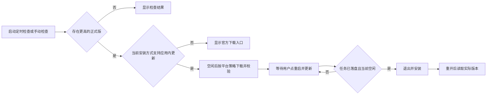

# Auto Meeting Recorder 自动更新设计

评审稿 · 2026-11-21 · 项目基线 `v2.8.3`（`a92993b`）

复用现有 GitHub Releases，正式安装版默认后台检查，有新版本时在空闲后自动下载。Linux AppImage（x64 和 arm64）优先差分，失败时自动回退到全包。Windows NSIS 直接下载全包，校验后由用户选择重启更新或手动打开未签名的安装包。Linux `.deb` 和 macOS 提供版本检测及官方下载入口。

## 1. Cherry Studio 的更新流程

以下以 Cherry Studio 主分支提交 [`e99451e`](https://github.com/CherryHQ/cherry-studio/commit/e99451ef5e7ca65aeb265d447b6844b624af9fd1) 为准。

| 环节 | Cherry Studio 的做法 |
| --- | --- |
| 更新来源 | 使用 `electron-builder` 打包和 `electron-updater` 执行检查、下载及安装。打包配置指向 `releases.cherry-ai.com`，主进程按地区、发行版和测试计划配置请求与渠道，正式版走 `latest`。发布工作流先准备并验证草稿资产，之后才公开发布。 [打包配置](https://github.com/CherryHQ/cherry-studio/blob/e99451ef5e7ca65aeb265d447b6844b624af9fd1/electron-builder.yml#L113-L207) · [发布流程](https://github.com/CherryHQ/cherry-studio/blob/e99451ef5e7ca65aeb265d447b6844b624af9fd1/.github/workflows/release.yml#L442-L472) |
| 检查 | 主进程在启动约 5 秒后开始定时检查，常规间隔 4 小时并带随机偏移。失败后按 5、10、20 分钟等间隔退避，最长 60 分钟。自动检查受设置控制，Windows 便携版跳过，用户可从「设置 → 关于」手动检查。 [更新服务](https://github.com/CherryHQ/cherry-studio/blob/e99451ef5e7ca65aeb265d447b6844b624af9fd1/src/main/services/AppUpdaterService.ts) · [关于页](https://github.com/CherryHQ/cherry-studio/blob/e99451ef5e7ca65aeb265d447b6844b624af9fd1/src/renderer/pages/settings/AboutSettings/AboutSettings.tsx) |
| 下载与展示 | 检查发现更新就进入下载。在库的 `autoDownload` 关闭时，检查路径也会显式调用 `downloadUpdate()`，所以关闭自动检查后，手动检查仍可触发下载。主进程推送新版本、进度、下载完成和错误事件，「关于」页和更新弹窗共用状态。手动检查完成下载时会弹出安装提示。 [下载实现](https://github.com/CherryHQ/cherry-studio/blob/e99451ef5e7ca65aeb265d447b6844b624af9fd1/src/main/services/AppUpdaterService.ts#L432-L535) · [界面事件处理](https://github.com/CherryHQ/cherry-studio/blob/e99451ef5e7ca65aeb265d447b6844b624af9fd1/src/renderer/windows/main/hooks/useAppUpdateHandler.ts) |
| Linux AppImage | 显式开启差分下载，由 `electron-updater` 读取运行中的旧 AppImage 与新版 AppImage 内嵌的分块清单。两个架构各有更新清单，下载源使用单区间 HTTP Range 请求。差分失败时下载完整 AppImage。 [更新服务](https://github.com/CherryHQ/cherry-studio/blob/e99451ef5e7ca65aeb265d447b6844b624af9fd1/src/main/services/AppUpdaterService.ts#L301-L319) · [打包配置](https://github.com/CherryHQ/cherry-studio/blob/e99451ef5e7ca65aeb265d447b6844b624af9fd1/electron-builder.yml#L182-L207) |
| 安装 | 显式关闭 `autoInstallOnAppQuit`。更新弹窗有「稍后」和安装操作，用户确认后，主进程标记即将退出，再调用 `quitAndInstall()`。 [安装弹窗](https://github.com/CherryHQ/cherry-studio/blob/e99451ef5e7ca65aeb265d447b6844b624af9fd1/src/renderer/components/UpdateDialogPopup.tsx) · [更新服务](https://github.com/CherryHQ/cherry-studio/blob/e99451ef5e7ca65aeb265d447b6844b624af9fd1/src/main/services/AppUpdaterService.ts#L533-L536) |

本项目保留「主进程调度、后台下载、用户确认重启」的流程。单一稳定渠道直接使用已有 GitHub 仓库，版本提示放到本应用的设置页。

## 2. 本项目现状与平台策略

- 当前使用 Electron 28，锁文件中的 `electron-builder` 为 26.8.1，`build.publish` 为 `null`。现有工作流在 `v*` 标签上汇总四个构建任务，并上传 EXE、DMG、AppImage 和 DEB。`v2.8.3` 的 Release 只有这六个安装资产，缺少更新清单。 [打包配置](../package.json) · [锁文件](../package-lock.json) · [构建工作流](../.github/workflows/build.yml) · [v2.8.3 发布](https://github.com/lester2pastm/auto-meeting-recorder/releases/tag/v2.8.3)
- 设置页「软件信息」已有版本号，来自主进程 `app.getVersion()`。录音音频和恢复文件在 `userData` 下，会议历史在 IndexedDB，设置使用 `electron-store` 并兼容现有存储读取。升级需保留应用标识、用户数据路径和历史记录的访问方式。 [设置页](../src/index.html#L482) · [主进程](../electron/main.js) · [存储](../src/js/storage.js)
- `v2.8.3` 的 Linux AppImage 约 239–241 MiB，Windows EXE 约 209 MiB。两个平台都包含离线语音模型。AppImage 差分可节省网络流量，本地仍需有空间写出完整的新版文件。两个平台均在空闲时发起下载。 [发布资产](https://api.github.com/repos/lester2pastm/auto-meeting-recorder/releases/tags/v2.8.3) · [内置模型说明](../README_CN.md#L183) · [electron-builder v26 更新指南](https://www.electron.build/v26/docs/features/auto-update/)

| 安装方式 | 首期行为 | 开放应用内安装的条件 |
| --- | --- | --- |
| Linux AppImage x64 / arm64 | 首期优先。自动检测，空闲后尝试差分，失败时自动下载全包，确认后重启安装。 | 两种架构分别验证更新来源、清单、整包 SHA-512 和实机升级。运行中的 AppImage 所在目录需允许替换，目录不可写时提供官方下载。 |
| Linux `.deb` | 检测后提供官方下载，通过系统包管理器安装。 | AppImage 更新清单只引用 AppImage。 |
| Windows NSIS x64 | 自动检测、空闲后下载完整 EXE，支持全包续传。签名版可选择重启更新，未签名版由用户打开安装包。 | 同次构建发布 EXE 和 `latest.yml`。签名版客户端验证预期发布者。 |
| macOS DMG | 检测后提供官方下载。 | 保留 DMG，并新增同一签名应用的 ZIP 和 `latest-mac.yml`。核对发行架构，验证 Developer ID 签名、公证和同签名升级。验证所选版本确实在用户确认时才把 ZIP 交给原生更新器。 [macOS 更新要求](https://www.electron.build/v26/docs/features/auto-update/) · [v26 更新器源码](https://github.com/electron-userland/electron-builder/blob/9418d2c0fb3608d7b348d18ab2a6b6393374fe75/packages/electron-updater/src/MacUpdater.ts#L210-L255) |
| 源码运行 | 显示当前版本。 | 更新流程只对正式打包构建生效，开发验证使用隔离的测试包。 |

当前发布工作流没有明确配置 Windows 签名凭据或 macOS 公证。本地已有的 Windows 解包 EXE 未签名，GitHub 正式包的签名状态仍需在实施时验证。签名和发布者验证是开放 Windows 自动安装的前置条件。 [当前工作流](../.github/workflows/build.yml) · [NSIS 签名验证实现](https://github.com/electron-userland/electron-builder/blob/9418d2c0fb3608d7b348d18ab2a6b6393374fe75/packages/electron-updater/src/NsisUpdater.ts)

## 3. 用户流程

1. 正式安装版启动后约 5 秒后台检查，后续每 4 小时检查一次。「软件信息」展示当前版本、检查状态和「检查更新」。默认开启「自动检查更新」，关闭后取消计划检查和待发起的自动下载，手动检查发现新版本时由用户点「下载更新」。已经开始的下载可以完成。
2. 只接受比当前版本高的正式版，按 SemVer 比较，例如 `2.10.0` 高于 `2.9.0`。支持应用内安装的包由更新器读取清单。其他包通过固定仓库的 GitHub 最新正式 Release 接口检测，按钮打开官方发布页。找不到当前平台的更新资产时提示「当前平台暂无可用更新包」。 [GitHub Releases API](https://docs.github.com/en/rest/releases/releases#get-the-latest-release)
3. 支持自动下载的平台发现更新后，等录音和会后处理空闲再开始下载。设置页显示目标版本、进度和「查看发布说明」。下载开始后，用户仍可发起会议，下载完成只更新状态。百分比到 100% 后显示「正在校验」，以更新器的 `update-downloaded` 事件作为可安装的依据。
4. 下载并校验完成后显示「重启并更新」，未签名的 Windows 版显示「打开安装包」。有进行中的任务时按钮不可用，并提示「当前操作完成后可更新」。用户可稍后从设置页发起安装。
5. 用户确认后，再验证候选版本仍在正式渠道并进入安全退出流程。重开后以实际运行版本确认升级成功。被撤回的候选版本取消安装资格。校验失败、网络不可用或升级后版本未变化时，保留当前版本状态，提供重试或官方下载入口。

## 4. 应用内实现边界

- **主进程统一管理更新。** 由 `electron/main.js` 在单实例就绪后初始化一个更新模块。模块持有状态、唯一检查任务、下载任务和定时器，合并重复点击和定时触发。库设置 `autoDownload = false`，由业务空闲状态触发下载。设置 `autoInstallOnAppQuit = false`、禁止预发行版和降级，Windows 禁用 NSIS 在线安装器。正常联网失败只做一次延迟重试，然后回到常规周期。清单缺失、签名失败和校验失败单独提示，限流不立即重试。
- **Linux AppImage 差分下载。** 通过运行环境的 `APPIMAGE` 路径识别安装方式。更新器从旧 AppImage 读取内嵌分块清单，按新清单的 `size` 和 `blockMapSize` 用 HTTP Range 读取新版文件末尾的分块清单。本地复制相同的块，下载变化的块，再按清单的 SHA-512 校验拼出的完整文件。分块清单无法读取、分段请求失败或拼包校验不通过时，由更新器自动下载新版全包并重新校验。安装前检查原 AppImage 所在目录可替换。 [AppImage 更新器](https://github.com/electron-userland/electron-builder/blob/9418d2c0fb3608d7b348d18ab2a6b6393374fe75/packages/electron-updater/src/AppImageUpdater.ts#L15-L67) · [内嵌分块实现](https://github.com/electron-userland/electron-builder/blob/9418d2c0fb3608d7b348d18ab2a6b6393374fe75/packages/electron-updater/src/differentialDownloader/FileWithEmbeddedBlockMapDifferentialDownloader.ts)
- **全包续传。** Linux AppImage 和 Windows NSIS 共用断点缓存与短重试。检查到同一版本、文件、大小和 SHA-512 时，从磁盘上的文件长度继续。发现新包时清除旧断点，AppImage 重新尝试差分，NSIS 直接下载新全包。服务器不接受续传时重新下载完整包。 [全包下载实现](../electron/update-download.js)
- **Windows NSIS 全包下载。** Windows 设置 `disableDifferentialDownload = true`，校验完整 EXE 的 SHA-512 后进入待安装状态。签名版同时校验预期发布者。 [NSIS 下载实现](https://github.com/electron-userland/electron-builder/blob/9418d2c0fb3608d7b348d18ab2a6b6393374fe75/packages/electron-updater/src/NsisUpdater.ts#L39-L75)
- **沿用 preload 与设置页。** `electron/preload.js` 只暴露读取状态、检查、下载、请求安装和订阅状态等有限能力。窗口重开时读取当前快照，随后接收变化。主进程校验调用来源和状态，更新仓库与外链由主进程固定。界面通过现有中英文词条呈现，发布说明跳转官方 GitHub 页面。 [现有桥接](../electron/preload.js) · [国际化](../src/js/i18n.js)
- **扩展已有退出判断。** `isExitProtectionActive()` 目前检查录音和录音工作流忙碌状态，无法完整覆盖导入、恢复、历史详情重试、重新生成纪要等独立操作。安装前让主进程请求当前窗口进入准备退出状态。渲染进程确认没有活动任务并暂时阻止新任务进入，同时等待音频文件写入、会议和设置的写入事务、恢复记录更新完成。IndexedDB 以事务 `complete` 事件判定提交，多项操作重叠时要等最后一项结束。主进程再确认 FFmpeg、本地转写会话和文件流已收尾。窗口未响应、状态未知或写入失败时继续运行并解除准备状态。 [退出及录音工作流](../src/js/app.js#L416-L456) · [导入和重试](../src/js/app.js#L1347-L1616) · [恢复界面](../src/js/recovery-ui.js) · [写入实现](../src/js/storage.js)
- **安装退出走受控路径。** 用户点击安装时，窗口先锁住新任务入口。AppImage 将已校验的新文件暂存于旧文件所在目录，复查任务状态后在原路径原子替换并重启。签名 Windows 版通过更新器启动已验证签名的安装程序。未签名版本在用户点击「打开安装包」后复核文件并打开，应用保持运行，由用户完成安装。安装交接前发生失败时恢复正常交互。 [窗口关闭与清理](../electron/main.js) · [安装实现](../electron/app-update.js)

## 5. GitHub 发布流程

1. 在 `package.json` 将 `electron-updater` 加入运行时依赖，锁定与现有 Electron、Node 和 builder 配合验证过的版本。通过 builder 的 GitHub provider 配置固定公开仓库，从打包应用的 `resources/app-update.yml` 读取源地址。客户端匿名读取，发布权限留在标签发布任务。
2. 各平台使用 `--publish never` 生成安装包和元数据，由汇总任务统一发布。Linux x64 上传 AppImage 与 `latest-linux.yml`，arm64 上传 AppImage 与 `latest-linux-arm64.yml`，逐项校验大小、分块表和 SHA-512。Windows x64 上传同次构建的 EXE 和 `latest.yml`，签名构建额外验证安装包签名及包内发布者配置。普通分支、PR 和手动构建只产出构建结果。 [当前工作流](../.github/workflows/build.yml) · [手动构建](../.github/workflows/manual-build.yml)
3. 汇总任务校验 tag 与应用版本一致，每份清单引用本次对应平台和架构的产物，SHA-512 与实际文件一致，资产名唯一。先上传到 Release 草稿，确认资产完整后再设为可见的正式 Release。Linux 差分依赖新版 AppImage 的分段下载和本机旧 AppImage。用隔离发布验证 GitHub 下载地址跟随重定向后能返回所请求的字节区间。 [更新元数据](https://www.electron.build/v26/docs/features/auto-update/)
4. 现有 `v2.8.3` 用户需手动覆盖安装首个带更新逻辑的版本，之后由该版本发现下一版。上线前用连续两个隔离的测试版本走通升级。正式版本发现故障时撤下问题更新入口，并用更高版本发布修复包。已下载并准备安装的客户端在交接前复查公开版本，已升级的客户端继续检查更高版本。

## 6. 实施顺序与验收

| 实施顺序 | 验收条件 |
| --- | --- |
| 首期 · 共用检测与界面 | 开发版不发更新请求。正式安装版启动后检查，手动与计划检查并发只产生一次请求。验证相同版本、`2.9.0 → 2.10.0`、旧版本、预发行版、无匹配安装包、断网和限流。关闭开关后仍可手动检查。 |
| 首期 · Linux AppImage 优先 | x64 和 arm64 各用真实打包版本验证差分与全包回退。用一对小改动的版本记录差分传输量，确认少于全包，并确认拼包 SHA-512 与发布清单一致。模拟分段请求失败，验证整包下载后仍能升级和重启。原文件目录不可写时保留旧版本并提供官方下载。DEB 交由系统包管理器处理。 |
| 首期 · 更新退出与数据保护 | 在开放应用内安装前，分别在录音、暂停、停止并保存、导入转写、生成纪要、恢复和历史重试时请求安装，均不得退出。覆盖用户点击更新的同时开始录音、窗口无响应、写入失败三种情况。正常升级后可查看旧纪要、播放旧音频、读取设置，并完成一次新录音与转写。 |
| 首期 · Windows NSIS 全包 | x64 旧版直接下载完整 EXE，中断后可续传。未签名版在用户确认后打开安装包，签名版通过发布者验证后安装。篡改后的文件、错误发布者及缺失清单均不能启动安装。推迟安装后仍可使用原版本。 |
| 后续 · macOS 应用内升级 | 验证选定架构、签名和 ZIP 更新后的重启行为。 |
